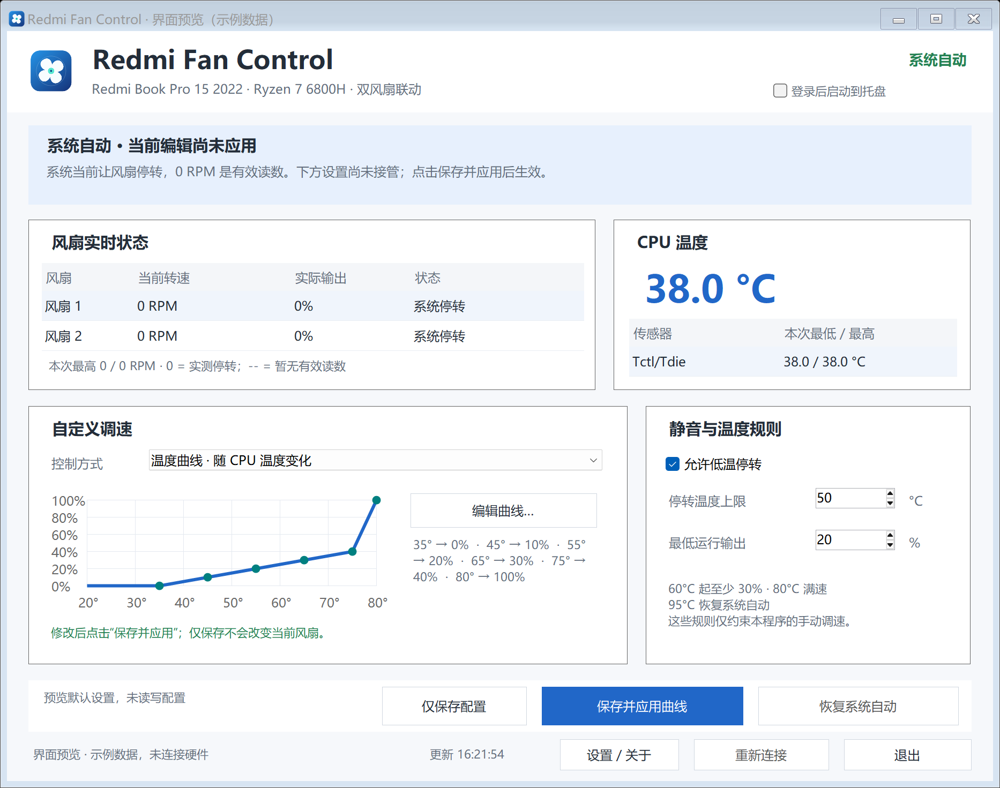

# Redmi Fan Control

Windows x64 原生风扇工具：实时温度 / 双风扇 RPM、0–100% 联动输出、目标 RPM、可视化温度曲线、配置保存与登录自启。

**0.9：下载 EXE，双击启动。无需 CMD，也无需另外携带模块文件夹。** 已安装官方 PawnIO 的机器可以直接使用；首次使用仍需安装该驱动并正常确认 UAC。



0.9.1 支持随窗口大小调整布局，最大化时卡片和曲线图会扩展，底部按钮跟随窗口边缘。[查看最大化预览（示例数据）](docs/images/main-maximized-preview.png)。

> **设备专用实验项目，不是通用笔记本调速工具。** 仅验证 Redmi Book Pro 15 2022 / Ryzen 7 6800H / BIOS RMARB5B0P1111 / EC P.11（IT5571）。其他设备或固件版本会拒绝控制。错误的风扇设置可能导致过热、数据丢失或硬件损坏，请阅读 [安全边界](docs/SAFETY.md)。本项目不属于小米、AMD、ITE、PawnIO 或 CrystalIDEA。

## 功能

- AMD CPU Tctl/Tdie 温度、两路真实 RPM 与实际 PWM 输出；不可用数据显示 `--`，不伪装成零。
- 手动 0–100% / 目标 0 或 1000–6000 RPM / 温度→输出曲线；固定百分比提供 0%、20%、30%、40%、50%、60%、80%、100% 预设。
- 两路共用模式和输出，RPM 闭环以较慢一路为准，不提供两路独立恒速。
- 可设置允许停转、停转温度上限和最低运行输出；节点表支持增删、排序、曲线预览。
- 显示“请求 → 执行目标 → 原因”，不存在隐藏补风回差；95°C 紧急恢复系统自动。
- 独立看护、传感器/失联/失速恢复、一键自动；正常退出恢复自动。
- JSON 配置校验、原子保存与备份。保存 ≠ 应用；重启不会自行恢复手动控制。
- 当前用户登录自启到托盘；窗口关闭可选择隐藏到托盘或退出，并可记住选择。**不自动提权、不自动弹 UAC、不自动接管风扇。**

## 下载与运行

1. 从本仓库 Releases 下载 `RedmiFanControl-<版本>-win-x64.exe`，保存到固定目录并双击。也提供含文档的 ZIP，解压后双击根目录的 `RedmiFanControl.exe`。
2. 从 [PawnIO 官方网站](https://pawnio.eu/) 安装官方 PawnIO。发布包不包含驱动安装器，也不会替你安装驱动。
3. 程序自动准备已内嵌的官方模块并校验 SHA-256；正常确认 UAC 后开始监测，默认由固件自动调速。
4. 选择控制方式，只编辑当前模式的控件，点击“保存并应用”。“仅保存配置”不会改变风扇，看到顶部“已生效”才表示后台已接管。
5. 随时点击“恢复系统自动”。第一次点击 × 会询问“隐藏到系统托盘”或“退出程序”，可以勾选记住选择；在“设置 / 关于”中可改回每次询问。隐藏到托盘会保持后台监测/调速，再次显示窗口会记住为窗口模式；正常退出会恢复系统自动。退出后风扇可能由固件缓慢降速，并非立即静音。

**0 RPM 与读取失败不同：** “系统停转 / 按设置停转”表示当前读到零转速；没有有效实时数据时显示 `--`。

配置、日志、模块和界面偏好保存在 `%LOCALAPPDATA%\RedmiFanControl`。风扇参数位于 `config/fan-control.json`，关闭行为和“下次启动显示窗口/停留托盘”位于 `config/ui-preferences.json`。在“设置 / 关于”中可打开数据目录、查看许可证和对应模块源码。将新版 EXE 放进旧安装根目录时，会读取旧的 `config/fan-control.json` 并迁移；已有新配置不会被覆盖。旧版正在运行时请先正常退出。

项目使用 .NET Framework 4.x、WinForms，依赖可运行 .NET Framework 4.8 的 Windows x64 环境。未签名的应用可能触发 Windows SmartScreen；请校验 Release 附带的 SHA256SUMS，不要为运行本工具关闭系统安全功能。

开机自启：在窗口右上角勾选“开机自启（登录后）”。关闭同一开关即可移除。它写入当前用户 Run 项，不创建服务或高权限计划任务。自启时双击托盘打开窗口，再点击“重新连接后台”并授权；移动/更新程序路径后请重新勾选自启开关。

## 温度规则

| 情况 | 执行 |
|---|---|
| 允许停转、请求低于最低输出、温度低于停转上限 | 0%，不算失速 |
| 达到停转上限（可设 35–60°C） | 至少按最低运行输出执行 |
| ≥60°C | 至少 max(30%, 最低运行输出) |
| ≥80°C | 100% |
| ≥95°C 或传感器/心跳等故障 | 恢复固件自动 |

降温后按当前采样立即重算，无额外隐藏 5°C 回差；阈值附近可能反复启停。非零目标启动时可助推 100% 至多 3 秒，实际连续 0 RPM 才算失速。实际执行仍有量化/固件延迟/惯性，不保证任意低百分比或 RPM 都稳定。95°C 不是建议运行温度。

## 从源码构建

在 Windows PowerShell 5.1 中执行：

```powershell
powershell -NoProfile -ExecutionPolicy Bypass -File scripts/Restore-Dependencies.ps1
powershell -NoProfile -ExecutionPolicy Bypass -File scripts/Test.ps1
powershell -NoProfile -ExecutionPolicy Bypass -File scripts/Package.ps1
```

第一步从固定官方版本下载模块和对应源码并检查 SHA-256，不运行下载内容。第二步构建并运行纯离线模拟测试，不需要 PawnIO、管理员或真实硬件。第三步生成独立 `.exe`、带文档的 `.zip` 和 `SHA256SUMS.txt`。新一次打包请使用新的输出目录，脚本不会覆盖已有发布文件。

不使用 NuGet，不在 CI 安装驱动或做负载/温度/EC 测试；使用系统 .NET Framework 编译器。版本在 `app/AssemblyInfo.cs`。

## GitHub 自动构建与发布

- Push 到 `main`、Pull Request、手动运行 Actions：固定依赖核验 → 构建 → 离线测试 → 独立 EXE / ZIP 验证 → Artifact。
- 推送与程序集一致的版本标签，例如 `v0.9.4`：上述步骤成功后自动创建 **实验性 Pre-release**，附 EXE、ZIP 和 SHA256SUMS。

- 只使用 GitHub 自动提供的 `GITHUB_TOKEN`，不需要 PAT；第三方 Actions 固定到完整提交 SHA。
- 已存在的 Release 不会被覆盖。版本不匹配、测试/哈希失败都会阻止发布。

0.9.5：增加 20% 低速静音预设；收紧关闭提示窗口的文字换行和控件间距，改善高 DPI 下的阅读与操作布局。

0.9.4：增加点击 × 的关闭选择，可隐藏到托盘或安全退出并记住选择；记住下次启动显示主窗口还是停留托盘；设置页可随时改回每次询问。偏好与风扇配置分离保存，并带备份恢复。

0.9.3：修复息屏/唤醒后的温度瞬时无效导致后台退出、误报自动恢复失败的问题；增加后台等待有效温度、系统唤醒处理和恢复自动后的自动重连。

0.9.2：修正小屏构建机上的布局测试，按内容坐标比较控件，避免把滚动位置变化误判成布局漂移。延续 0.9.1 的窗口布局修复。

0.9.1：修复最大化后内容留在左上角；增加窗口放大、还原、小窗口滚动及三种模式布局回归。

0.9.0：单 EXE、按模式显示编辑区、明确停转与断连、保存失败阻止应用、异步安全退出、旧配置迁移。详见 [重构分析与回归范围](docs/REFACTOR-0.9.md)。

首次发布步骤见 [发布指南](docs/PUBLISHING.md)。本地准备好工作流不等于它已经在你的 GitHub 账号上运行成功。

## 代码导航

见 [代码结构与流程](docs/ARCHITECTURE.md)、[控制逻辑复盘](docs/CONTROL_LOGIC_REVIEW.md)、[安全说明](docs/SAFETY.md) 和 [贡献指南](CONTRIBUTING.md)。

## 许可证

项目自有代码及原创图标：MIT。PawnIO 模块保持其 LGPL-2.1 许可证；发布包保留 `COPYING` 以及固定上游提交的 `source.zip`。PawnIO 驱动和 PawnIOLib 由用户自行从官方安装，并不在本包再分发。见 [第三方说明](THIRD-PARTY-NOTICES.md)。
